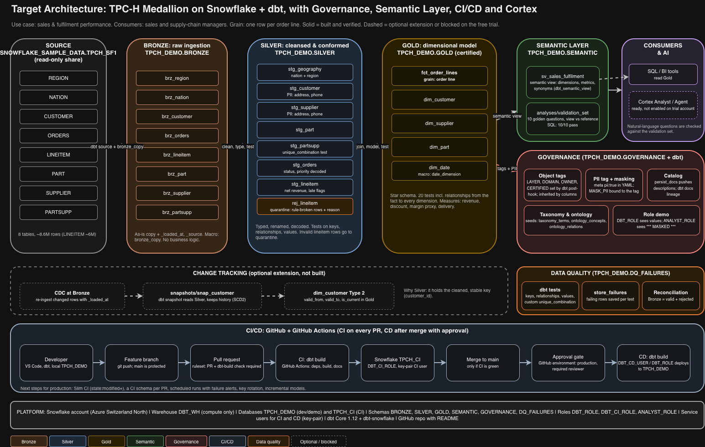
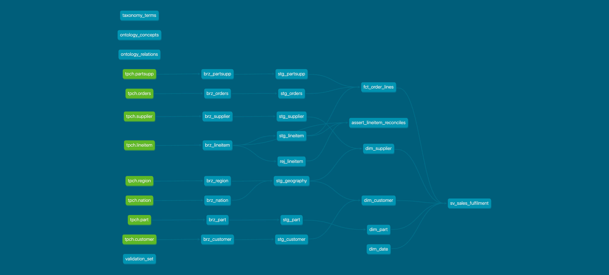

# TPC-H Medallion on Snowflake with dbt

A Bronze → Silver → Gold pipeline built entirely with dbt on Snowflake, using the
TPC-H SF1 sample data. The Gold layer is a star schema for sales and fulfilment
performance, with a semantic layer, governance (tags, PII masking), data-quality
controls and a CI/CD pipeline around it.

## Use case

**Consumer:** sales and supply-chain managers.
**Questions answered:** revenue by region, segment and month; which customers and
parts drive revenue and margin; which suppliers deliver late; how discounts affect
revenue.
**Grain of the fact table:** one row per order line.

## Architecture



| Layer | Schema | What it holds | How it is built |
|---|---|---|---|
| Source | `SNOWFLAKE_SAMPLE_DATA.TPCH_SF1` | 8 TPC-H tables (read-only share) | Provided by Snowflake |
| Bronze | `BRONZE` | Raw copy of each source table plus `_loaded_at` and `_source` | One macro (`bronze_copy`) called 8 times |
| Silver | `SILVER` | Renamed columns, fixed types, readable labels, line-level metrics, quarantine table | 7 models plus `rej_lineitem` |
| Gold | `GOLD` | `fct_order_lines` and 4 dimensions (customer, supplier, part, date) | 5 models, date dimension from a macro |
| Semantic | `SEMANTIC` | `sv_sales_fulfilment`, a Snowflake semantic view on the Gold star | dbt model (package `dbt_semantic_view`) |
| Governance | `GOVERNANCE` | Tags, masking policy, taxonomy and ontology seed tables | dbt hooks, seeds and a setup script |
| Data quality | `DQ_FAILURES` | Rows that fail dbt tests | `store_failures` on all tests |

The lineage graph generated by dbt:



## Design decisions

- **Why Medallion:** each layer has one job, so a wrong number can be traced back
  layer by layer, and each layer can be tested on its own.
- **Bronze:** a copy we own, with load metadata, no business logic. The source is
  a read-only share that we do not control.
- **Silver:** cleaning and conforming (names, types, labels, derived line metrics).
  Anything that can be calculated from a single row lives here; anything that
  needs several rows (sums, rates) belongs in Gold.
- **Gold:** a star schema with a named consumer. Nation and region are folded into
  the customer and supplier dimensions to keep it simple for BI tools.
- **Materialisation:** tables in all layers. Views would also work for Silver.
- **Schema naming:** a `generate_schema_name` override gives clean `BRONZE`,
  `SILVER` and `GOLD` schemas instead of dbt's default prefixed names.
- **Orchestration inside a run:** dbt builds the dependency graph from `ref()` and
  `source()`, runs independent models in parallel and skips everything downstream
  of a failed test.
- **Re-runs:** every model is rebuilt with `create or replace`, so running the
  project again gives the same business data (only the `_loaded_at` audit column
  changes).

## Data quality

Quality is checked at every layer, and a failing test stops the layers after it.

- **Tests:** `unique`, `not_null`, `relationships`, `accepted_values`, plus a
  custom generic test `unique_combination` for composite keys.
- **Stored failures:** `store_failures` saves the rows of every failing test in the
  `DQ_FAILURES` schema, so they can be investigated.
- **Quarantine:** `stg_lineitem` holds only valid order lines. Rows that break a
  rule go to `rej_lineitem` with the reason (`discount out of range`,
  `receipt before ship`, `non-positive quantity`). The rules live in one macro,
  `lineitem_reject_reason`, and the discount limit is a dbt variable
  (`max_discount`, default 0.10).
- **Reconciliation:** the test `assert_lineitem_reconciles` checks that every Bronze
  row ends up in exactly one of the two tables.
- **Validation set:** `analyses/validation_set.sql` answers ten business questions
  two ways (hand-written SQL on Gold vs `SEMANTIC_VIEW()` queries). All ten match.

TPC-H is synthetic and clean, so no rows are rejected by default. To see the
quarantine working, run a stricter threshold:

```bash
dbt build --select stg_lineitem rej_lineitem assert_lineitem_reconciles --vars '{max_discount: 0.05}'
```

and rebuild with the default afterwards: `dbt build --select stg_lineitem+ rej_lineitem`.

## Governance

- **Object tags:** `LAYER`, `DOMAIN`, `OWNER` and `CERTIFIED` are applied to every
  table by a dbt post-hook from the `meta` configuration. Tags on a table are
  inherited by its columns.
- **PII:** columns marked `meta: pii: true` in the YAML (customer and supplier
  `address` and `phone`) get the `PII` tag.
- **Masking:** a masking policy `MASK_PII` is attached to the `PII` tag, so every
  tagged column is masked automatically. `DBT_ROLE` sees real values; any other
  role, such as `ANALYST_ROLE`, sees `*** MASKED ***`. The policy is created by
  `setup/02_masking.sql`.
- **Catalog:** `persist_docs` writes the model and column descriptions into
  Snowflake, and `dbt docs` provides the lineage graph.
- **Taxonomy and ontology:** stored as seed tables in the `GOVERNANCE` schema
  (`taxonomy_terms`, `ontology_concepts`, `ontology_relations`).

## CI/CD

**CI** (`.github/workflows/dbt_ci.yml`) runs on every pull request to `main` and on
every merge. It installs dbt on a GitHub runner and runs `dbt deps`, `dbt build`
(seeds, models and tests) and `dbt docs generate` in a separate `TPCH_CI` database,
using a limited role (`DBT_CI_ROLE`) and a key-pair service user. `main` is
protected by a ruleset that requires a pull request and a passing `dbt-build`
check.

**CD** (`.github/workflows/dbt_cd.yml`) runs after a merge to `main` and can also be
started by hand. The deploy job uses the GitHub environment `production`, which
requires a reviewer's approval. After approval it runs `dbt build --target prod`
against `TPCH_DEMO` as a separate service user (`DBT_CD_USER`, role `DBT_ROLE`)
and saves the dbt docs as an artifact. A concurrency rule prevents two deployments
from running at the same time.

**Secrets** (names only, the values live in GitHub and never in the repository):

- Repository: `SNOWFLAKE_ACCOUNT` and the CI user and private key.
- Environment `production`: `SNOWFLAKE_CD_USER` and `SNOWFLAKE_CD_PRIVATE_KEY`.

**Setup scripts:** `setup/01_ci.sql` creates the CI role, database and user;
`setup/03_cd.sql` creates the deploy user.

## Semantic layer and Cortex

The semantic view is deployed from code and validated against reference SQL.
The natural-language agent is not run in this project, because Cortex AI features
are disabled on Snowflake free trial accounts. See `docs/cortex_readiness.md`.

## Not built yet

- CDC and SCD Type 2 (a dbt snapshot on customers, read by a Type 2 customer
  dimension).
- The Cortex natural-language agent (blocked by the trial account).
- Data contracts, incremental models and Slim CI (see the roadmap below).

## How to run it

### Prerequisites

- A Snowflake account (a free trial is enough) with the `SNOWFLAKE_SAMPLE_DATA`
  database available.
- Python 3.12 and git.

### 1. Create the Snowflake objects

Run `setup/00_bootstrap.sql` as `ACCOUNTADMIN`. It creates the warehouse `DBT_WH`,
the role `DBT_ROLE` and the database `TPCH_DEMO`, and grants the role to your user.

### 2. Configure the dbt connection

Create `~/.dbt/profiles.yml`. This file stays outside the repository on purpose,
because it holds credentials:

```yaml
tpch_medallion:
  target: dev
  outputs:
    dev:
      type: snowflake
      account: <your_account_identifier>   # for example abc12345-xy67890
      user: <your_user>
      password: <your_password>            # or private_key_path for key-pair auth
      role: DBT_ROLE
      database: TPCH_DEMO
      warehouse: DBT_WH
      schema: DBT_DEV
      threads: 4
```

### 3. Install and build

```bash
git clone https://github.com/AlexandreMilanSerra/tpch_medallion.git
cd tpch_medallion
python3.12 -m venv .venv && source .venv/bin/activate
pip install dbt-core==1.12.6 dbt-snowflake==1.12.5
dbt deps
dbt debug        # expect: All checks passed!
dbt build        # expect: ERROR=0
```

### 4. Create the PII masking policy (once)

After the first build the PII tags exist. Run `setup/02_masking.sql` in Snowflake.
Its comments say which statements run as `ACCOUNTADMIN` and which as `DBT_ROLE`.
Afterwards `ANALYST_ROLE` sees `*** MASKED ***` in the address and phone columns,
and `DBT_ROLE` sees the real values.

### 5. Check and explore

```bash
dbt show --select validation_set --limit 20   # semantic view vs reference SQL
dbt docs generate && dbt docs serve           # lineage graph
```

CI/CD needs its own setup scripts and GitHub secrets (see above) and is not
required to run the project locally.

## Production roadmap

- **Orchestration:** a scheduled run with failure alerts (Snowflake Tasks, GitHub
  Actions on a schedule, dbt Cloud, or Airflow/Dagster when upstream ingestion has
  to be coordinated).
- **CI/CD:** Slim CI with `state:modified+`, a CI schema per pull request, key
  rotation, and environments per branch.
- **Data quality:** quarantine for the other Silver tables, a write-audit-publish
  pattern so consumers never read unvalidated data, severity thresholds on tests,
  data contracts (`contract: enforced`) and profiling dashboards.
- **Performance and cost:** incremental models for `lineitem`, cost monitoring and
  separate warehouses per workload.
- **Idempotent setup scripts:** make the one-off setup SQL safe to re-run.
- **History:** CDC at Bronze and an SCD Type 2 customer dimension.
