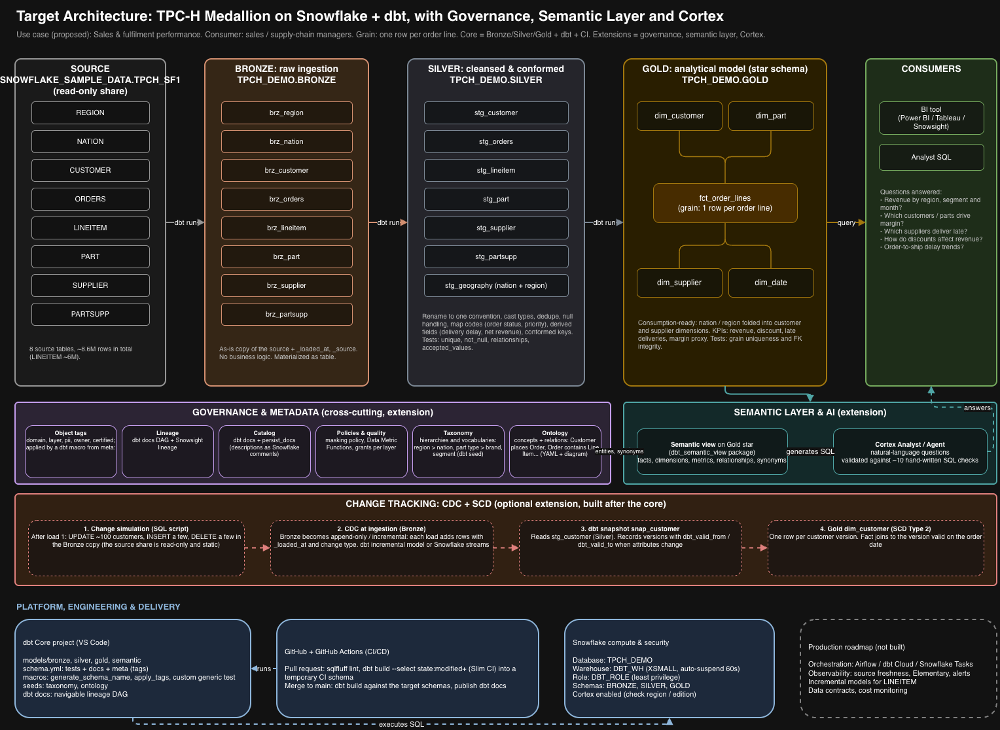

# TPC-H Medallion on Snowflake with dbt

A Bronze → Silver → Gold pipeline built entirely with dbt on Snowflake, using the
TPC-H SF1 sample data. The Gold layer is a star schema for sales and fulfilment
performance, with a semantic layer on top.

## Use case

**Consumer:** sales and supply-chain managers.
**Questions answered:** revenue by region, segment and month; which customers and
parts drive revenue and margin; which suppliers deliver late; how discounts affect
revenue.
**Grain of the fact table:** one row per order line.

## Architecture



| Layer | Schema | What it holds | How it is built |
|---|---|---|---|
| Source | `SNOWFLAKE_SAMPLE_DATA.TPCH_SF1` | 8 TPC-H tables (read-only share) | Provided by Snowflake |
| Bronze | `BRONZE` | Raw copy of each source table plus `_loaded_at` and `_source` | One macro (`bronze_copy`) called 8 times |
| Silver | `SILVER` | Renamed columns, fixed types, readable labels, line-level metrics | 7 models |
| Gold | `GOLD` | `fct_order_lines` and 4 dimensions (customer, supplier, part, date) | 5 models, date dimension from a macro |
| Semantic | `SEMANTIC` | `sv_sales_fulfilment`, a Snowflake semantic view on the Gold star | dbt model (package `dbt_semantic_view`) |
| Governance | `GOVERNANCE` | Taxonomy and ontology as seed tables | dbt seeds |

## Design decisions

- **Why Medallion:** each layer has one job, so a wrong number can be traced back
  layer by layer, and each layer can be tested on its own.
- **Bronze:** a copy we own, with load metadata, no business logic. The source is
  a read-only share that we do not control.
- **Silver:** cleaning and conforming (names, types, labels, derived line metrics).
  TPC-H is synthetic and already clean, so the tests prove that rather than invent
  problems.
- **Gold:** a star schema with a named consumer. Nation and region are folded into
  the customer and supplier dimensions to keep it simple for BI tools.
- **Materialisation:** tables in all layers. Views would also work for Silver.
- **Schema naming:** a `generate_schema_name` override gives clean `BRONZE`,
  `SILVER` and `GOLD` schemas instead of dbt's default prefixed names.

## Testing

- Built-in tests: `unique`, `not_null`, `relationships`, `accepted_values`.
- Custom generic test `unique_combination` for composite keys.
- `analyses/validation_set.sql`: ten business questions answered two ways
  (hand-written SQL on Gold vs `SEMANTIC_VIEW()` queries). All ten match.

## CI/CD

GitHub Actions (`.github/workflows/dbt_ci.yml`) runs `dbt build` on every pull
request and on every merge to `main`, in a separate `TPCH_CI` database with its own
limited role and a key-pair service user. `main` is protected by a ruleset that
requires a pull request and a passing `dbt-build` check. dbt docs are saved as a
workflow artifact.

Deployment to the demo database is manual. In production this would be a separate
job with its own production role and approval.

## Semantic layer and Cortex

The semantic view is deployed from code and validated against reference SQL.
The natural-language agent is not run in this project, because Cortex AI features
are disabled on Snowflake free trial accounts. See `docs/cortex_readiness.md`.

## Not built yet

- Governance: object tags, `persist_docs` and masking policy.
- CDC and SCD Type 2 (dbt snapshot on customers).

## How to run it

1. Run `setup/00_bootstrap.sql` in Snowflake as `ACCOUNTADMIN` (warehouse, role,
   database).
2. Create `~/.dbt/profiles.yml` for a profile called `tpch_medallion`
   (Snowflake, role `DBT_ROLE`, database `TPCH_DEMO`, warehouse `DBT_WH`).
3. Install and run:

```bash
python3 -m venv .venv && source .venv/bin/activate
pip install dbt-core==1.12.6 dbt-snowflake==1.12.5
dbt deps
dbt build
dbt docs generate && dbt docs serve
```

## Production roadmap

Orchestration (Airflow, dbt Cloud or Snowflake Tasks), observability (source
freshness, Elementary, alerts), incremental models for `lineitem`, Slim CI with
`state:modified+`, data contracts, cost monitoring and separate warehouses per
workload.